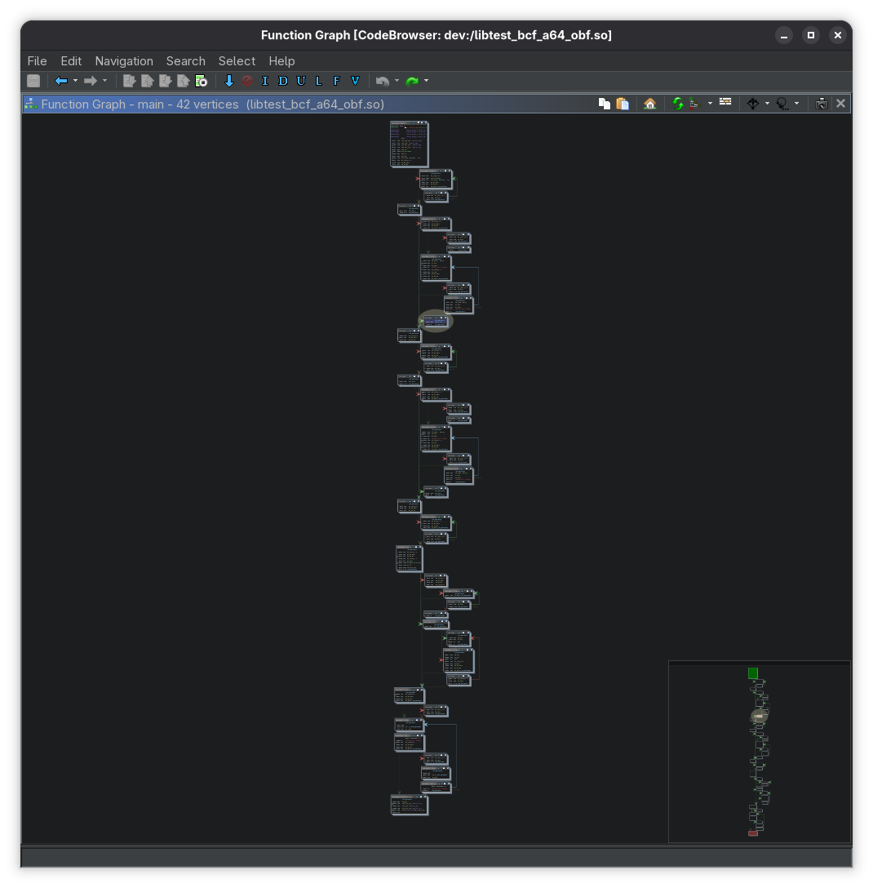
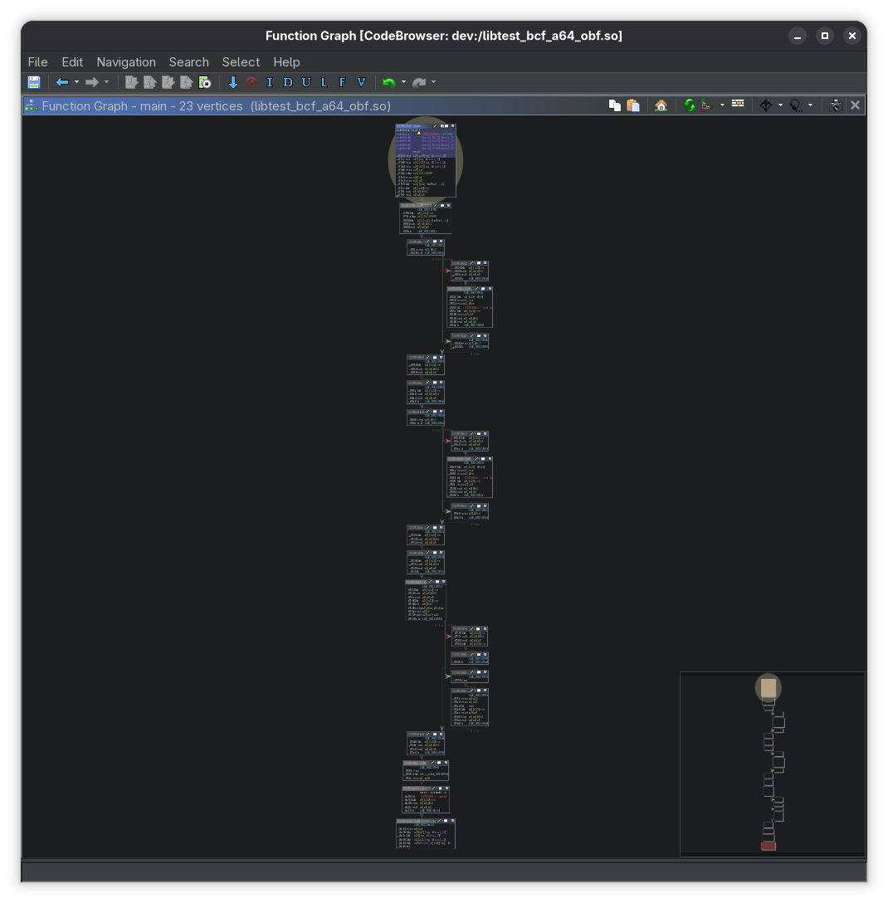

# Ghidra

## Use case

Deobfuscate [bogus control flow (bcf)](./obfuscator-llvm.md#explanation).

## Usage

Script Manager --> Manage Script Directories --> add/enable `$USER_HOME/ghidra_scripts`

```
$ cp deobf-bcf.py $HOME/ghidra_scripts/
```

```
deobf-bcf.py> Running...
x    @ 00130db0
y    @ 00130db4
x.1  @ 00130db8
y.2  @ 00130dbc
main: patched 16 opaque branch(es)
deobf-bcf.py> Finished!
```

```py
{{#include scripts/deobf-bcf.py}}
```

```c
#include <stdio.h>
#include <stdlib.h>

__attribute__((noinline)) static int mix(int a, int b) {
  int r = 0;
  for (int i = 0; i < b; i++) {
    if (i & 1)
      r += a ^ i;
    else
      r -= a & i;
  }
  return r;
}

int main(int argc, char **argv) {
  int a = argc > 1 ? atoi(argv[1]) : 7;
  int b = argc > 2 ? atoi(argv[2]) : 3;
  int r;

  if (a > b)
    r = a - b;
  else
    r = mix(a, b);

  printf("r=%d\n", r);
  return 0;
}
```

```sh
#!/usr/bin/env bash
set -euo pipefail

LLVM=/opt/llvm/bin
PLUGIN=$PWD/../build/libLLVMObfuscator.so
SYSROOT=/opt/a64
T="--target=aarch64-linux-gnu --sysroot=$SYSROOT"

SRC=test_bcf.c
OUT=test_bcf_a64

export LLVM_OBF_SEED=0xA04252B187478C00A40BC6D81D1A8A52

$LLVM/clang $T -O1 -S -emit-llvm $SRC -o ${OUT}.ll
$LLVM/llc --relocation-model=pic -filetype=obj ${OUT}.ll -o ${OUT}.o
$LLVM/clang $T -fuse-ld=lld ${OUT}.o -o ${OUT}

$LLVM/opt -load "$PLUGIN" -load-pass-plugin "$PLUGIN" \
	-bcf_prob=100 -bcf_loop=1 \
	-passes='function(bogus)' -S ${OUT}.ll -o ${OUT}_obf.ll

$LLVM/llc --relocation-model=pic -filetype=obj ${OUT}_obf.ll -o ${OUT}_obf.o
$LLVM/clang $T -fuse-ld=lld ${OUT}_obf.o -o ${OUT}_obf

echo "opaque globals in IR:"
grep -E '^@(x|y)(\.[0-9]+)? ' ${OUT}_obf.ll || true

$LLVM/clang $T -shared -fuse-ld=lld ${OUT}_obf.o -o lib${OUT}_obf.so
```

Before:

```c
undefined8 main(int param_1,long param_2)

{
  int iVar1;
  int iVar2;
  int param1;
  long lVar3;
  
  do {
    if ((x * (x + -1) & 1U) == 0) break;
  } while (9 < y);
  if (param_1 < 2) {
    iVar1 = 7;
  }
  else {
    if (((x * (x + -1) & 1U) != 0) && (9 < y)) goto LAB_0011087c;
    while( true ) {
      lVar3 = strtol(*(char **)(param_2 + 8),(char **)0x0,10);
      iVar1 = (int)lVar3;
      if (((x * (x + -1) & 1U) == 0) || (y < 10)) break;
LAB_0011087c:
      strtol(*(char **)(param_2 + 8),(char **)0x0,10);
    }
  }
  do {
    if ((x * (x + -1) & 1U) == 0) break;
  } while (9 < y);
  if (param_1 < 3) {
    iVar2 = 3;
  }
  else {
    if (((x * (x + -1) & 1U) != 0) && (9 < y)) goto LAB_00110918;
    while( true ) {
      lVar3 = strtol(*(char **)(param_2 + 0x10),(char **)0x0,10);
      iVar2 = (int)lVar3;
      if (((x * (x + -1) & 1U) == 0) || (y < 10)) break;
LAB_00110918:
      strtol(*(char **)(param_2 + 0x10),(char **)0x0,10);
    }
  }
  do {
    if ((x * (x + -1) & 1U) == 0) break;
  } while (9 < y);
  param1 = iVar1 - iVar2;
  if (param1 == 0 || iVar1 < iVar2) {
    if ((x * (x + -1) & 1U) != 0 && 9 < y) goto LAB_001109c8;
    while ((param1 = mix(iVar1,iVar2), (x * (x + -1) & 1U) != 0 && (9 < y))) {
LAB_001109c8:
      mix(iVar1,iVar2);
    }
  }
  else {
    do {
      if ((x * (x + -1) & 1U) == 0) break;
    } while (9 < y);
  }
  if (((x * (x + -1) & 1U) != 0) && (9 < y)) goto code_r0x00110a24;
  while ((printf("r=%d\n",param1), (x * (x + -1) & 1U) != 0 && (9 < y))) {
code_r0x00110a24:
    printf("r=%d\n",param1);
  }
  return 0;
}
```



After:

```c
/* WARNING: Removing unreachable block (ram,0x00110968) */

undefined8 main(int param_1,long param_2)

{
  int iVar1;
  int iVar2;
  int param1;
  long lVar3;
  
  if (param_1 < 2) {
    iVar1 = 7;
  }
  else {
    lVar3 = strtol(*(char **)(param_2 + 8),(char **)0x0,10);
    iVar1 = (int)lVar3;
  }
  if (param_1 < 3) {
    iVar2 = 3;
  }
  else {
    lVar3 = strtol(*(char **)(param_2 + 0x10),(char **)0x0,10);
    iVar2 = (int)lVar3;
  }
  param1 = iVar1 - iVar2;
  if (param1 == 0 || iVar1 < iVar2) {
    param1 = mix(1,iVar1,iVar2);
  }
  printf("r=%d\n",param1);
  return 0;
}
```


