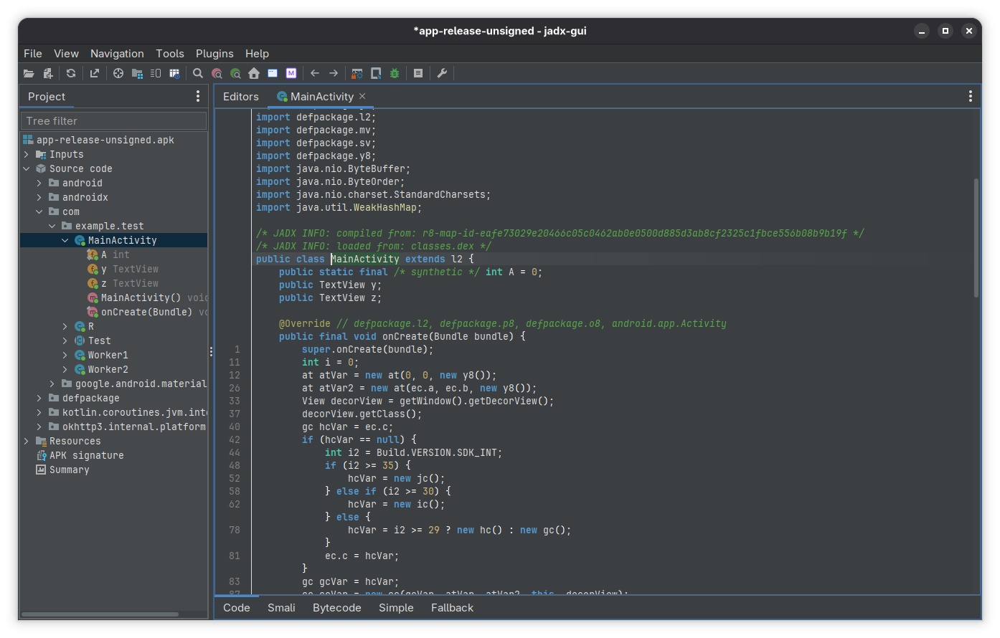
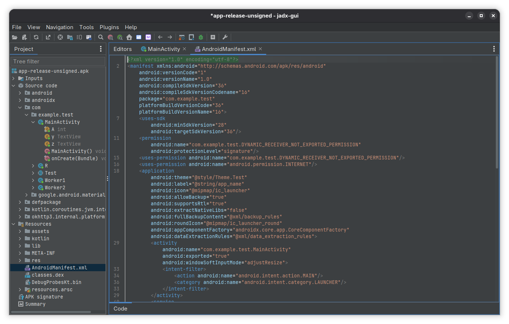

# JADX

## Use case

Decompile APK and .dex files.

## Explanation

- decompile APK and .dex files into Java sources
- decode `AndroidManifest.xml`

## Usage

GUI:

```
$ jadx-gui app/build/outputs/apk/release/app-release-unsigned.apk
```





CLI:

```
$ jadx -d out-release app/build/outputs/apk/release/app-release-unsigned.apk
INFO  - loading ...
INFO  - processing ...
ERROR - finished with errors, count: 4
$ head -n 5 out-release/resources/AndroidManifest.xml
<?xml version="1.0" encoding="utf-8"?>
<manifest xmlns:android="http://schemas.android.com/apk/res/android"
    android:versionCode="1"
    android:versionName="1.0"
    android:compileSdkVersion="36"
```
